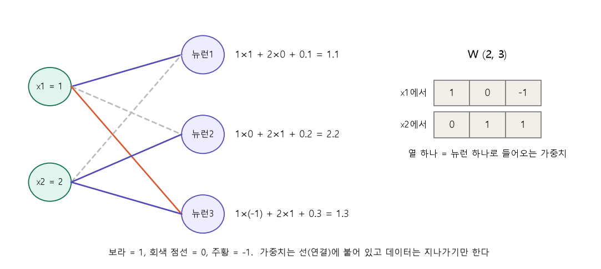
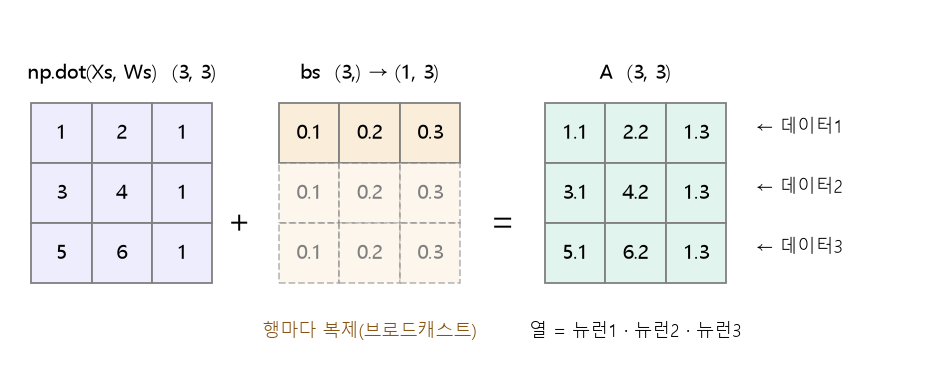

# 3·4장 남은 문제 풀이

> 3·4장에서 못 푼 48문제(`ch03_04_unsolved.ipynb`)를 푼 날의 정리.
> **진행:** 1~3구역(3장 Part 7, 4장 Part 5·6) + 4장 복습 **Part A·B** 전부 통과 ✅
> **남은 것:** Part C(meshgrid) · D(행렬로 그래프) · E(이름표와 상자) → 5장 진도 나가면서 남는 시간에 풀기

## 목차
1. [[#1. 행렬 곱의 결과 읽기 — 행 = 데이터, 열 = 뉴런]]
2. [[#2. 브로드캐스트 — 편향은 어떻게 더해지나]]
3. [[#3. 은닉층에 뉴런을 여러 개 두는 이유]]
4. [[#4. 인덱싱 — 숫자로 꺼내기 vs 목록으로 꺼내기]]
5. [[#5. `shape[0]` · `size` · `len` 그리고 reshape]]
6. [[#6. 오차제곱합(책) vs 평균 제곱 오차(일반)]]
7. [[#7. 파이썬은 곱하기를 생략하지 않는다]]
8. [[#8. 기울기는 오르막을 가리킨다]]
9. [[#9. 그 밖에 짚은 것]]
10. [[#10. 내가 한 실수 모음 (11-18)]]
11. [[#11. 다음에 할 것]]

---

## 1. 행렬 곱의 결과 읽기 — 행 = 데이터, 열 = 뉴런
`A = np.dot(Xs, Ws) + bs` — `Xs`(3, 2) 데이터 3개, `Ws`(2, 3) 뉴런 3개 → `A`(3, 3)



- **가중치는 데이터가 "갖게 되는" 게 아니다.** 신경망의 **선(연결)마다 붙박이로** 달려 있고, 데이터는 그 위를 지나가기만 한다.
- 값이 선을 지나면 **그 선의 가중치가 곱해지고**, 뉴런은 들어온 값을 **다 더한 뒤 자기 편향을 더한다.**
- `W`의 **열 하나** = 뉴런 하나로 들어오는 가중치 / `W`의 **행 하나** = 입력 하나에서 나가는 가중치
- 데이터1·2·3 모두 **같은 W, 같은 b**를 지난다. 결과를 한 줄씩 쌓은 게 `A`.
- 결과 읽기: **행(가로줄) = 데이터 하나가 뉴런들에서 낸 출력**, **열(세로줄) = 뉴런 하나가 데이터마다 낸 출력**
- 가중치는 출력을 계산할 때는 절대 안 바뀌고, **학습(`W -= lr * grad`)할 때만** 바뀐다.

## 2. 브로드캐스트 — 편향은 어떻게 더해지나


`(3, 3) + (3,)`이 되는 이유: 넘파이가 `bs`를 **행마다 복제**해서 더한다.
- 편향은 **뉴런의 성질**이라 어떤 데이터가 와도 같은 뉴런에는 같은 편향 → 같은 **세로줄**에 같은 값.
- 그래서 배치 크기가 바뀌어도 `b`의 모양은 `(뉴런 수,)` 그대로.

**규칙: 오른쪽 끝부터 맞춘다**
> 모양을 오른쪽 끝에 맞춰 세우고, 빈자리는 앞(왼쪽)에 1을 채운다. 칸마다 **같거나 한쪽이 1**이면 1인 쪽을 늘린다.

| 계산 | 오른쪽 정렬 | 결과 |
|:-:|:-:|:-:|
| `(3, 3) + (3,)` | `(3, 3)` / `(1, 3)` | 행 하나를 아래로 복제 |
| `(3, 3) + (3, 1)` | `(3, 3)` / `(3, 1)` | 열 하나를 옆으로 복제 |
| `(3, 3) + (2,)` | `(3, 3)` / `(1, 2)` | 3 ≠ 2 → **에러** |

- 1차원 `(3,)`은 **항상 `(1, 3)` 행 하나**로 취급된다. 저절로 `(3, 1)`이 되는 일은 없다.
- "열 쪽 복제"는 배열이 **처음부터 `(N, 1)`**일 때만 — `reshape(-1, 1)`, `np.max(x, axis=1, keepdims=True)` 등.
- 기준은 "넘파이가 알아서 고른다"가 아니라 **"그 배열의 모양이 원래 무엇이냐"**.

## 3. 은닉층에 뉴런을 여러 개 두는 이유
- **출력층**: 뉴런 하나 = 답 후보 하나의 점수 → 개수는 **문제가 정한다** (MNIST·Fashion-MNIST = 10).
- **은닉층**: 뉴런 하나 = **입력을 보는 관점(특징) 하나**. 뉴런마다 가중치가 달라서 입력의 다른 조합을 본다.
  - 위 그림: 뉴런1은 x1만, 뉴런2는 x2만, 뉴런3은 "x2가 x1보다 얼마나 큰가"를 본다.
  - MNIST라면 "위쪽에 동그란 획?", "가운데 세로선?" 같은 특징 — 사람이 정해 주지 않고 **학습하면서 저절로** 생긴다.
- `TwoLayerNet(input_size=784, hidden_size=50, output_size=10)` → **784·10은 정해진 값, 50은 내가 고른 값.**
  - 너무 적으면 특징이 부족, 너무 많으면 느리고 훈련 데이터를 외워 버림(6장).

## 4. 인덱싱 — 숫자로 꺼내기 vs 목록으로 꺼내기
대괄호 안을 **쉼표로 나눠 자리마다** 본다.
- **숫자** → 그 축이 **사라진다** (값만 꺼냄)
- **`:`** → 그 축 그대로
- **목록** → 그 축이 **목록 길이만큼 남는다** (상자째 꺼냄)
- 단, 목록이 **두 자리에 다 있으면** → **짝지어서** 축 하나로 합쳐진다 (좌표 목록)

`M = np.arange(12).reshape(3, 4)`

| | 숫자 (축 사라짐) | 목록 (축 남음) |
|:-:|:-:|:-:|
| 행 쪽 | `M[1]` → `(4,)` → `[4 5 6 7]` | `M[[1]]` → `(1, 4)` → `[[4 5 6 7]]` |
| 열 쪽 | `M[:, 1]` → `(3,)` → `[1 5 9]` | `M[:, [1]]` → `(3, 1)` → `[[1] [5] [9]]` |

- `M[1]`과 `M[[1]]`은 **든 숫자는 같고 대괄호 겹수가 다르다.** 목록으로 꺼내면 번호가 하나여도 "행 1개짜리 표".
- 슬라이스도 마찬가지: `x[9:12]` → 9 하나만 남아도 `9`가 아니라 `[9]`.

**목록 하나 vs 목록 둘** (`Ys`는 (3, 3) 확률, `ts = [1, 1, 0]`)

| 코드 | 뜻 | 결과 |
|:-:|:-:|:-:|
| `Ys[ts]` | 목록 하나 → 1, 1, 0번 **행 통째로** | `(3, 3)` ❌ |
| `Ys[np.arange(3), ts]` | 목록 둘 → `(0,1)`, `(1,1)`, `(2,0)` **칸 하나씩** | `(3,)` ✅ |
| `P[np.arange(4)][t]` | 대괄호가 **나뉨** → 행 묶음을 두 번 꺼냄 | `(4, 3)` ❌ |

- `P[[0, 1], [2, 0]]`은 **모든 조합(2×2)이 아니라 같은 순서끼리 짝** → `[0.7, 0.5]`, 결과 모양 = 목록 모양 `(2,)`.

**책에서 쓰는 건 이 세 가지면 충분**

| 코드 | 쓰는 곳 | 모양 |
|:-:|:-:|:-:|
| `x[i]` | 데이터 하나 | `(784,)` |
| `x_train[batch_mask]` | 미니배치 (목록 하나 → 행 묶음) | `(100, 784)` |
| `y[np.arange(N), t]` | 교차 엔트로피 (목록 둘 → 정답 칸) | `(N,)` |

헷갈리면 외우지 말고 `print(결과.shape)`.

## 5. `shape[0]` · `size` · `len` 그리고 reshape
| | 뜻 | `(10,)` | `(5, 10)` |
|:-:|:-:|:-:|:-:|
| `y.size` | **전체 원소 개수** | 10 | 50 |
| `len(y)` / `y.shape[0]` | **첫 번째 축의 길이** | 10 | 5 |

- 1차원 `np.zeros(10)`은 `[0. 0. ... 0.]` 한 줄(`(10,)`)이다. 축이 하나뿐이라 `shape[0]`이 **10** → "데이터 1개"인데 10개로 세 버린다.
- 그래서 1차원이면 `y = y.reshape(1, y.size)` → `(1, 10)`, 첫 축이 확실히 데이터 수(1).
  - `.T`(전치)는 **있는 두 축을 바꾸는** 것 → 1차원에서는 아무 일도 안 한다.
  - `reshape(len(y), 1)` = `(10, 1)` = **데이터 10개**라는 뜻이 되어 버린다.
- 추천: 원소 전부 → `y.size`, 데이터(행) 개수 → `y.shape[0]`.

**돌려받은 값은 다시 담아야 한다**
```python
y.reshape(1, y.size)        # ❌ 새 배열을 만들어 돌려주고 버려짐. y는 그대로
y = y.reshape(1, y.size)    # ✅

as_batch(y)                 # ❌ 함수가 돌려준 걸 안 담음
y = as_batch(y)             # ✅
```
- 함수 안에서 `y = ...`로 바꿔도 **함수 안의 이름표만** 새 상자로 옮겨 붙는다. 바깥 이름표는 옛 상자 그대로 → Part E에서 더 다룸.

## 6. 오차제곱합(책) vs 평균 제곱 오차(일반)
| 이름 | 식 | 책 예제 `y1`, `t1` |
|:-:|:-:|:-:|
| **오차제곱합 (SSE, 책 4.2.1)** | $\frac{1}{2}\sum_k (y_k - t_k)^2$ | 0.0975 |
| 평균 제곱 오차 (MSE, 일반) | $\frac{1}{n}\sum_k (y_k - t_k)^2$ | 0.0195 |

- 책이 쓰는 건 **오차제곱합**. 노트북(그리고 [[4장 신경망 학습]] 노트)에 "평균 제곱 오차"라고 적었던 건 이름이 잘못된 것.
- 일반 MSE는 내 생각대로 **개수로 나눈다**. 순서는 **제곱 먼저, 평균은 나중** (먼저 평균 내면 +/− 오차가 서로 지워짐).
- 책의 ½은 평균이 아니라 **미분을 깔끔하게** 하려고: $(y-t)^2$ 미분 → $2(y-t)$, ½과 약분 → $(y-t)$. (5장에서 나옴)
- `/2`와 `0.5 *`는 같다. 변수 이름을 `sum`으로 쓰면 내장 함수 `sum()`을 덮어쓰니 `total` 등으로.

## 7. 파이썬은 곱하기를 생략하지 않는다
- **이름 바로 뒤의 괄호는 무조건 "함수 부르기".** 안에 숫자가 들었는지 함수가 들었는지 따지지 않는다.
```python
a = 3
a * (2)    # 6
a(2)       # TypeError: 'int' object is not callable
```
| 수학 | 파이썬 |
|:-:|:-:|
| $2h$ | `2*h` |
| $a(t-x)$ | `a*(t - x)` |
| $\dfrac{f(x+h)-f(x-h)}{2h}$ | `(f(x+h) - f(x-h)) / (2*h)` |

- 접선: `diff_f = numerical_diff(f, x)`는 **숫자(기울기)** → `lambda t: diff_f*(t - x) + f(x)`. 같은 줄의 `f(x)`는 `f`가 함수라서 괄호가 맞다.
- `/ 2*h`는 `(… / 2) * h`로 계산된다 → 분모는 괄호로 묶기.

## 8. 기울기는 오르막을 가리킨다
`function_2` = $x_0^2 + x_1^2$, 기울기 $(2x_0, 2x_1)$

| 점 | 기울기 | 원점(최솟값) 쪽 |
|:-:|:-:|:-:|
| (1, 1) | (2, 2) 오른쪽 위 | (−, −) 왼쪽 아래 |
| (−1, 2) | (−2, 4) 왼쪽 위 | (+, −) 오른쪽 아래 |

- 기울기 = 함수 값이 **가장 빨리 커지는** 방향. 최솟값으로 가려면 **반대(−)**.
- 그림 4-9의 `quiver(..., -grad[0], -grad[1])`, 경사 하강법의 `x -= lr * grad`의 `-`가 같은 이유.

## 9. 그 밖에 짚은 것
- **SGD** = Stochastic Gradient Descent(확률적 경사 하강법). Stochastic = 미니배치를 **무작위로** 뽑음, Gradient = 그 손실의 기울기, Descent = 기울기 반대로 내려감. 6장에서 Momentum·AdaGrad·Adam과 비교.
- **딕셔너리 갱신 루프**
```python
for key in params:                      # 키(이름표) 'W', 'b'가 하나씩
    params[key] -= lr * grads[key]      # 같은 키로 짝 → W의 기울기로 W를 갱신
```
  - `-=`는 딕셔너리 안 **그 상자 자체**를 고친다. `params[key] = params[key] - …`은 새 상자를 만들어 이름표를 옮긴다.
- **배치 정확도 한 줄**: `np.sum(np.argmax(y, axis=1) == t) / y.shape[0]` — `axis=1` = 행(데이터)마다. `axis=0`이면 클래스마다라서 개수가 달라 `t`와 비교 불가.
- **배치로 자르기**: `range(0, 10, 3)` → 0, 3, 6, 9 / `x[9:12]` → `[9]` (끝을 넘어가면 있는 만큼만).
- **배치 손실**: 데이터마다 `-np.log(P[np.arange(N), t] + 1e-7)` → 평균이 배치 교차 엔트로피. `P`가 이미 확률이면 softmax를 또 씌우지 않는다.
- **노트북 변수**: A-3의 `M`은 A-1 확인 셀에서 만든 것 — 셀은 **실행한 순서대로** 변수가 남는다. 커널을 재시작했으면 앞 셀부터.
- **원-핫 → 정답 숫자**: `np.argmax(T5, axis=1)` — 모양을 적어 둔 메모 `shape_guess = (4, 3)`을 넣으면 안 된다(그건 데이터가 아니라 숫자 2개).

## 10. 내가 한 실수 모음 (11-18)
| 문제 | 내가 쓴 것 | 왜 틀렸나 | 고친 것 |
|---|---|---|---|
| 7-3 | `last_batch = 9` | 마지막 `i`(시작 번호)를 적음. 슬라이스 결과는 조각 | `[9]` |
| 6-2 | `predict_ax1`에 6개 | `axis=1` → 행마다 1개, 행이 3개 | `[1, 1, 1]` |
| 6-3 | `Ys[ts]` | 목록 하나 → 행 통째로 `(3, 3)` | `Ys[np.arange(Ys.shape[0]), ts]` |
| A-1 | `M[1]` → `(1, 4)`, `M[[1]]` → `(3,)` | 숫자 = 축 사라짐, 목록 = 축 남음을 거꾸로 | `(4,)`, `(1, 4)` |
| A-1 | `M[:, 1]` → `(2, 4)` → `(3, 1)` | 열을 숫자로 꺼내면 열 축이 사라짐 | `(3,)` |
| A-2 | `P[[0,1],[2,0]]` → `[[0.7,0.1],[0.1,0.5]]` → `[[0.7],[0.5]]` | 모든 조합 X, 짝지어 칸 하나씩, 결과 = 목록 모양 | `[0.7, 0.5]` |
| A-2 🔁 | `-np.log(softmax(P[np.arange(4)][t]))` | 대괄호가 나뉨 + 이미 확률인데 softmax + `1e-7` 없음 | `-np.log(P[np.arange(P.shape[0]), t] + 1e-7)` |
| A-2 🔁 | `acc = np.argmax(P, axis=0) == t` | 축이 반대 + 정확도가 아니라 True/False 목록 | `np.sum(np.argmax(P, axis=1) == t) / P.shape[0]` |
| A-4 | `return y.T` | 1차원에 `.T`는 아무 일도 안 함 | `y = y.reshape(1, y.size)` |
| A-4 | `y.reshape(...)`만 쓰고 안 담음 | reshape는 원본을 안 바꿈 | `y = y.reshape(...)` |
| A-4 | `count_data`에서 `as_batch(y)`만 | 돌려받은 값을 버림 | `y = as_batch(y)` |
| B-1 | `/ y.shape[0]` | 책 식은 ½(오차제곱합). 1차원이라 shape[0]=10 | `/ 2` |
| B-5 | (이해) `diff_f(t - x)` | 숫자를 함수처럼 부름 | `diff_f*(t - x)` |
| B-8 | `shape_guess = np.argmax(Ts, …)` | `Ts` 오타 + 버그 줄이 아닌 메모 줄을 고침 | `labels5 = np.argmax(T5, axis=1)` |

## 11. 다음에 할 것
- [ ] `ch03_04_unsolved.ipynb` **Part C·D·E** (Claude와 같이)
- [ ] `ch04_fashion.ipynb` (Fashion-MNIST)
- [ ] 5장 오차역전파법 — `ch05_backprop\ch05_practice.ipynb`
- [ ] **5장 끝나고 인덱싱·모양 다시 복습** (숫자 vs 목록, 목록 하나 vs 둘, `shape[0]`, 돌려받은 값 담기)
- [ ] 4장 노트에 4-4 이후 내용 + 정리하기로 한 질문들 추가 (말하면)
