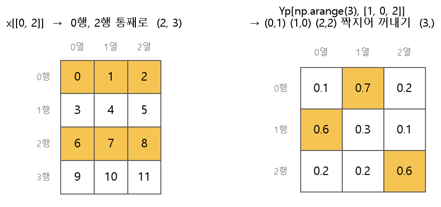
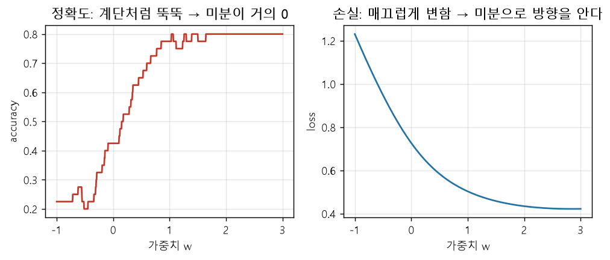
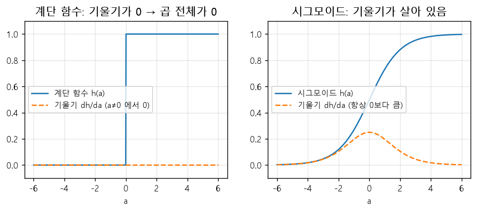
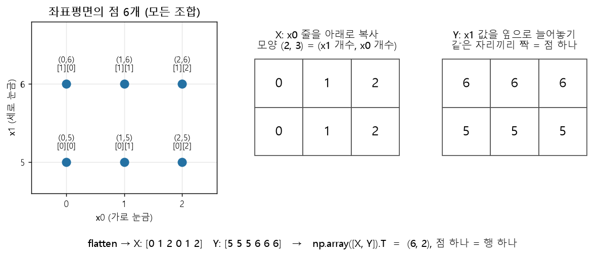
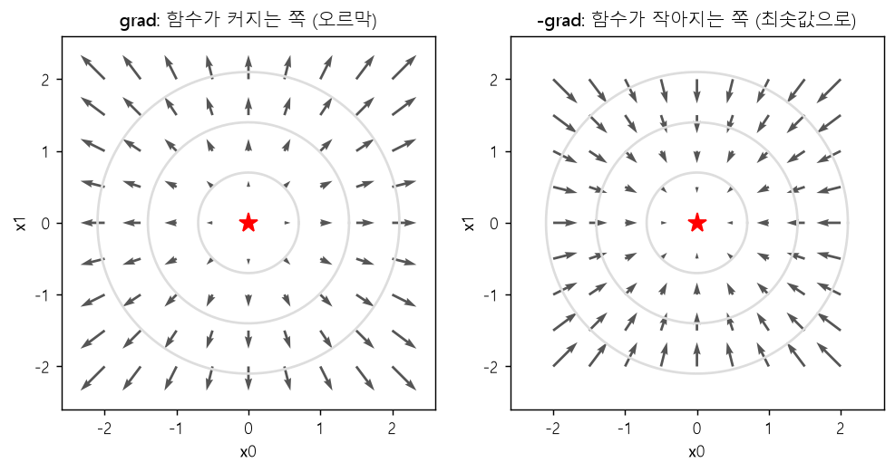
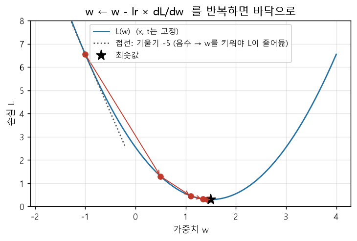

# 4장 신경망 학습

> **학습** = 훈련 데이터로부터 가중치의 최적값을 자동으로 찾는 것.
> 지표는 **손실 함수**. 손실이 작아지는 방향(**기울기의 반대**)으로 가중치를 조금씩 고친다 → **경사 하강법**.

## 목차
1. [[#0. 준비 — 책 저장소에서 복사한 파일]]
2. [[#1. 데이터에서 학습한다 (4.1)]]
3. [[#2. 손실 함수 (4.2)]]
4. [[#3. 수치 미분 (4.3)]]
5. [[#4. 기울기 (4.4)]]
6. [[#5. 내가 한 실수 모음]]
7. [[#6. 다음에 할 것]]

---

## 0. 준비 — 책 저장소에서 복사한 파일
`book_source\deep-learning-from-scratch\common` → `C:\Deeplerning\common`

| 파일 | 안에 든 것 | 왜 |
|---|---|---|
| `functions.py` | `sigmoid`, `softmax`, `cross_entropy_error` | 4.4.2 simpleNet, 4.5 TwoLayerNet이 import |
| `gradient.py` | `numerical_gradient` (2차원 `W`도 받음) | 가중치의 기울기 |
| `__init__.py` | 빈 파일 | `common`을 패키지로 인식 → `from common.functions import ...` |

```bash
cp book_source/deep-learning-from-scratch/common/__init__.py book_source/deep-learning-from-scratch/common/functions.py book_source/deep-learning-from-scratch/common/gradient.py common/
```
- `cp 원본1 원본2 원본3 목적지/` — 여러 파일을 한 폴더로 복사 (원본은 그대로).
- ⭐ `sigmoid_grad`, `two_layer_net.py`의 `gradient()`는 **5장(오차역전파법)** 내용.

---

## 1. 데이터에서 학습한다 (4.1)
- 손글씨 인식 세 가지 방법: ① 사람이 알고리즘 ② 사람이 특징(SIFT, HOG) 설계 + 기계학습 ③ **신경망: 이미지 그대로, 처음부터 끝까지 기계가 배움** (종단간 학습)
- **훈련 데이터**로 학습 → **시험 데이터**로 범용 능력(처음 보는 데이터) 평가
- 훈련 데이터에만 지나치게 맞춰진 상태 = **오버피팅**(과대적합)

---

## 2. 손실 함수 (4.2)

### 평균 제곱 오차 / 교차 엔트로피 오차
$$E_{MSE} = \frac{1}{2}\sum_k (y_k - t_k)^2 \qquad E_{CEE} = -\sum_k t_k \log y_k$$
```python
def mean_squared_error(y, t):
    return 0.5 * np.sum((y - t) ** 2)       # (t-y)*(t-y)도 같은 값

def cross_entropy_error(y, t):
    delta = 1e-7
    return -np.sum(t * np.log(y + delta))
```
- `t`는 **정답(target)**. 원-핫이면 정답 자리만 1 → CEE는 **정답 자리의 $-\log y$만 남는다.**
- `1e-7` = $1 \times 10^{-7}$ = 0.0000001 (`e`는 자연상수가 아니라 "×10의 거듭제곱"). **띄어쓰기 없이** 써야 숫자.
- `np.log(0)` = `-inf` → 아주 작은 `delta`를 더해 막는다.

### 왜 앞에 `-`를 붙이나?
확률 $y$는 0~1 → $\log y \le 0$ (음수). `-`를 붙여야 **손실 ≥ 0**, 잘 맞힐수록 0에 가까움.

| 정답 자리 확률 | `np.log(y)` | `-np.log(y)` |
|:-:|:-:|:-:|
| 1.0 | 0 | 0 |
| 0.6 | -0.51 | 0.51 |
| 0.1 | -2.30 | 2.30 |

### 원-핫 → 정답 숫자: `argmax`와 `axis`
- `np.argmax(t)` — 1차원이면 그대로 위치.
- ⚠️ **2차원에 `axis` 없이** 쓰면 행마다가 아니라 **전체를 한 줄로 펴서** 찾는다. (`T`의 1이 처음 나오는 칸이 1번이라 우연히 1이 나왔음)
- 행(데이터)마다: `np.argmax(T, axis=1)`

### 미니배치 (4.2.3)
```python
batch_mask = np.random.choice(train_size, batch_size)  # 0~59999 중 '번호' 10개
x_batch = x_train[batch_mask]                          # 그 번호의 행들
```
- `batch_mask`는 True/False 배열이 아니라 **행 번호 목록**이다. (`x_train[[0, 5, 9]]`와 같은 방식)

### `[0]` vs `[[0]]` — 숫자로 꺼내기 vs 목록으로 꺼내기
| 코드 | 뜻 | 모양 |
|---|---|---|
| `x_train[0]` | 0번 행 | `(784,)` — 행 축이 **사라짐** |
| `x_train[0][0]` | 0번 행의 0번 값 | 숫자 하나 |
| `x_train[[0]]` | 번호 목록 `[0]`의 행들 | `(1, 784)` — 행 축이 **남음** |
| `x_train[[0, 5, 9]]` | 행 3개 묶음 | `(3, 784)` |

> 요령: **안쪽 괄호 = 리스트**라고 읽기. 목록으로 꺼내면 개수가 1개여도 "행 묶음"(2차원).



### 배치용 CEE (4.2.4)
```python
def cross_entropy_error(y, t):          # 원-핫 정답
    if y.ndim == 1:
        t = t.reshape(1, t.size)        # ⚠️ 결과를 다시 담아야 한다
        y = y.reshape(1, y.size)
    batch_size = y.shape[0]
    return -np.sum(t * np.log(y + 1e-7)) / batch_size

def cross_entropy_error(y, t):          # 정답이 숫자(레이블)
    ...
    return -np.sum(np.log(y[np.arange(batch_size), t] + 1e-7)) / batch_size
```

**reshape는 언제 필요한가?** — "행 개수 = 데이터 개수"로 세는 코드(`y.shape[0]`)가 있을 때.

| `y` 모양 | `y.shape[0]` | |
|---|---|---|
| `(10,)` 그대로 | 10 ❌ | 데이터 1개를 10개로 착각 → 손실이 10분의 1 |
| `(1, 10)`로 reshape | 1 ✅ | |

`np.log`, `*`, `np.sum`처럼 **원소끼리** 계산만 하면 reshape가 필요 없다.

**왜 batch_size로 나누나?** — 합은 데이터 개수에 따라 커진다. 평균을 내야 배치 크기와 상관없이 "데이터 1개당 얼마나 틀렸나"로 비교할 수 있다.
```
Y = [y1, y2] → 손실 0.51 + 2.30 = 2.81 → ÷ 2 = 1.41
배치 10장: 합 약 5 / 평균 0.5     배치 100장: 합 약 50 / 평균 0.5
```

**`y[np.arange(N), t]` — 짝지어 꺼내기** (중요! 5장에서도 계속 나옴)
- `np.arange(N)` = 행 번호 `[0, 1, ..., N-1]`, `t` = 열 번호 → **같은 순서끼리 짝**
- `Yp[np.arange(3), [1, 0, 2]]` → `Yp[0,1], Yp[1,0], Yp[2,2]` → `[0.7, 0.6, 0.6]` (그림 오른쪽)
- 정답이 아닌 자리는 원-핫 `t`가 0이라 원래 식에서도 사라지니까, **정답 자리 확률만 뽑아도 같은 값**이다.
- ⚠️ `np.arange(y.size)`가 아니라 `np.arange(batch_size)` — `y.size`는 원소 전체 개수.

### 왜 정확도가 아니라 손실 함수를 지표로? (4.2.5)
- 정확도는 **맞힌 개수를 세는 값**. 가중치를 조금 바꿔서 확률이 0.600 → 0.601이 돼도 **1등이 안 바뀌면** 정확도는 그대로.
- 변화가 0 → **미분이 0** → 어느 쪽으로 가야 할지 모른다. 1등이 뒤바뀌는 순간에만 '뚝'.
- 손실은 확률이 조금 변하면 같이 조금 변한다 (0.5108 → 0.5092) → 항상 방향을 알려 준다.



### 같은 이유로 계단 함수 대신 시그모이드 (내가 생각해 낸 것 ✨)
신경망 = 함수를 겹친 것: `w → a = w·x + b → h(a) → ... → L`. 미분은 단계별 변화율의 **곱**:
$$\frac{\partial L}{\partial w} = \frac{\partial L}{\partial h} \times \frac{\partial h}{\partial a} \times \frac{\partial a}{\partial w}$$
- 계단 함수면 $\frac{\partial h}{\partial a}$가 거의 어디서나 **0** → 곱 전체가 0 → 손실을 아무리 매끄럽게 해도 기울기가 사라진다.
- 시그모이드는 기울기가 어디서도 0이 아님 → 살아남는다.
- 이렇게 겹친 함수의 미분을 곱으로 쪼개는 것 = **연쇄 법칙** → 5장 오차역전파법의 핵심.



---

## 3. 수치 미분 (4.3)

### 나쁜 구현 → 개선 (4.3.1)
- `h = 1e-50` ✗ → `np.float32(1e-50)` = **0.0** (반올림 오차: 너무 작은 수는 0이 됨). float32는 약 `1e-45`, 파이썬 float는 약 `1e-308`까지.
- 개선: `h = 1e-4` + **중심 차분**
```python
def numerical_diff(f, x):
    h = 1e-4
    return (f(x + h) - f(x - h)) / (2 * h)
```
- ⚠️ `/ 2*h`는 **왼쪽부터** 계산 → 2로 나누고 h를 **곱함**. 나누는 쪽이 여러 개면 `( )`로 묶기.
- ⚠️ `2h`처럼 곱셈 기호 생략 불가 → `2 * h`.

### 접선 — 함수를 돌려주는 함수 (`lambda`)
- 기울기만 **수치 미분**으로 구하고, 나머지는 직선 공식.
- 파이썬에서 함수도 값 → 변수에 담고 `return` 가능. `lambda t: 식` = 이름 없는 한 줄 함수.
```python
def make_line(a, b):
    return lambda t: a * t + b   # a, b를 기억하는 '직선 함수'
line = make_line(2, 1); line(3)  # 7

def tangent_line(f, x):
    d = numerical_diff(f, x)
    return lambda t: d * (t - x) + f(x)   # 점-기울기 꼴 (책: d*t + (f(x) - d*x), 같은 식)
```
- ⚠️ `d(t - x)`는 `d`를 **함수로 부르기** → `'float' object is not callable`. `d * (t - x)`.

### 편미분 (4.3.3)
- 다른 변수는 **숫자로 고정**한 함수를 만들어 `numerical_diff`에 넣는다. **미분은 직접 하지 않는다.**
```python
def function_tmp1(x0):
    return x0 * x0 + 4.0 ** 2.0          # x1 = 4 고정 (미분한 식 X)
numerical_diff(function_tmp1, 3.0)        # 6.0
```

---

## 4. 기울기 (4.4)

### `numerical_gradient` — 모든 변수의 편미분을 벡터로
```python
def numerical_gradient(f, x):
    h = 1e-4
    grad = np.zeros_like(x)          # x와 모양·자료형이 같은 0 배열 (빈 칸 미리 만들기)
    for i in range(x.size):
        tmp_val = x[i]               # 원래 값 저장
        x[i] = tmp_val + h;  fxh1 = f(x)   # 이 칸만 +h (복사 대신 원본 한 칸만 바꿈)
        x[i] = tmp_val - h;  fxh2 = f(x)
        grad[i] = (fxh1 - fxh2) / (2 * h)
        x[i] = tmp_val               # 복원! 안 하면 다음 칸 계산 때 이 칸이 틀어져 있음
    return grad
```
- ⚠️ 정수 배열 `np.array([3, 4])`를 넣으면 `3 + 0.0001`이 잘려서 3 → 엉뚱한 값. `np.array([3.0, 4.0])`.
- 기울기는 **항상 미분 대상과 같은 모양** (`dW`도 `W`와 같은 모양).

### 여러 점의 기울기 — `numerical_gradient_2d` (책 `gradient_2d.py`, 혼자 짬 ✨)
```python
def numerical_gradient_2d(f, X):
    if X.ndim == 1:                          # 점 하나 (ndim = 차원 수, 개수 아님)
        return numerical_gradient(f, X)
    grad = np.zeros_like(X)
    for idx, x in enumerate(X):              # 바깥 반복: 점(행)을 하나씩
        grad[idx] = numerical_gradient(f, x) # 안쪽 반복: 그 점의 변수 2개
    return grad
```
- 점 3개 `(3, 2)` → 기울기 `(3, 2)`. 점 개수는 `X.shape[0]`.
- 작은 함수를 만들고 **조합**해서 큰 문제를 푼다 → 5장 계층 쌓기와 같은 생각.

### `meshgrid` — 격자 점 만들기
눈금 `x0`, `x1`의 **모든 조합** = 좌표평면의 격자 점.
- `X`, `Y` 표의 모양 = 좌표평면 모양 = **(x1 개수, x0 개수)**
- `X`: x0 줄을 x1 개수만큼 **아래로 복사** / `Y`: x1 값을 x0 개수만큼 **옆으로**
- 같은 자리 `[i][j]`끼리 짝 = 점 하나. 방향을 엇갈리게 복제하니까 중복 없이 모든 점 (X는 빠르게, Y는 느리게 바뀜 — 분침과 시침).
- `flatten`: 위 행부터 펴기. 두 표를 같은 순서로 펴니까 **짝이 유지**된다.
- `np.array([X, Y])` = 두 줄 쌓기 `(2, N)` → `.T` → `(N, 2)` = **점 하나 = 행 하나** → `numerical_gradient_2d`에 넣는 모양



### 그림 4-9 직접 그리기 (혼자 짬 ✨)
```python
x0 = np.arange(-2, 2.5, 0.25)              # 18개
X, Y = np.meshgrid(x0, x0)                 # (18, 18)
X = X.flatten(); Y = Y.flatten()           # 각 324
grad = numerical_gradient_2d(function_2, np.array([X, Y]).T)   # (324, 2)
plt.quiver(X, Y, -grad[:, 0], -grad[:, 1]) # 시작점 X,Y / 방향 U,V
plt.show()
```
- `plt.quiver(X, Y, U, V)`: n번 화살표는 점 `(X[n], Y[n])`에서 `(U[n], V[n])` 방향.
- `grad.T[0]` = `grad[:, 0]` (0번 열 = 모든 점의 x0 방향 기울기).

**왜 `-grad`?** 기울기는 함수가 **가장 빨리 커지는** 방향(오르막). 최솟값으로 가려면 반대 방향.
- 1차원: $x^2$의 `x=3` 기울기 +6 = "오른쪽으로 가면 커진다" → 최솟값은 왼쪽 → −6 방향
- 2차원: (3, 4)의 기울기 (6, 8)은 원점에서 멀어지는 쪽 → (−6, −8)이 바닥 쪽
- 경사 하강법 `x -= lr * grad`도 같은 이유. 화살표 하나하나 = "여기서 한 걸음 가면 좋은 방향".



### 손실 함수에 경사 하강법을 어떻게 쓰나? (4.4.2 미리)
- 미니배치를 정하면 `x`, `t`는 **고정된 숫자** → 바꿀 수 있는 건 가중치뿐 → **손실 = 가중치의 함수** $L(W)$.
- `W`는 실수라서 연속으로 움직일 수 있고, `np.dot`·sigmoid·softmax·log가 모두 매끄럽다 → 데이터는 띄엄띄엄이어도 **W에 대해서는** 미분 가능.
- 출력층 함수가 아니라 **손실 L을 각 가중치로** 미분: 가중치 하나만 ±h → 손실 다시 계산 → 차이 ÷ 2h. 모든 가중치에 대해 → `dW`.
- `W -= lr * dW`. 손실이 클 때는 보통 기울기도 커서 많이 고쳐지고, 가까워질수록 조금씩.
- 코드에서는 `f = lambda w: net.loss(x, t)` = "`x`, `t` 고정, 가중치만 바뀌는 손실 함수".



---

## 5. 내가 한 실수 모음
| 실수 | 증상 | 원인 / 해결 |
|---|---|---|
| MSE에 `return` 없음, `0.5` 빠짐 | `None` / 0.195 | `return 0.5 * np.sum(...)` |
| 2차원에 `np.argmax(T)` | 1이 나옴 (행마다 아님) | 전체를 펴서 찾음 → `axis=1` |
| `label`을 `T`에서 꺼냄 | | 문제는 소문자 `t`(2-1의 정답 하나) |
| `picked_labels = (10, 783)` | | 모양이 아니라 **정답 숫자**를 구하는 문제 |
| `np.argmax(predict_c, axis=1)` | AxisError | `predict_c`는 예측 메모(튜플). 데이터 `t_train[[0, 5, 9]]`를 넣기 |
| `x_train[[0]]`을 `x_train[0][0]`으로 생각 | `(1,)`로 예측 | 안쪽 괄호 = 행 번호 리스트 → `(1, 784)` |
| `t.reshape(1, t.size)`만 씀 | 손실이 10분의 1 | `t = t.reshape(...)` 다시 담기 |
| `[0,7, 0.6, 0.6]` | 원소 4개 | `0.7`의 점이 쉼표로 |
| `y.ydim`, `np.arrange` | AttributeError | `ndim`, `arange` |
| `np.arange(y.size)` | IndexError | 행 개수 `batch_size` |
| CEE에 `-` 빠짐 | 손실이 음수 | `-np.sum(...)` |
| `1e - 4` | SyntaxError | 붙여서 `1e-4` |
| `/ 2h`, `/ 2*h` (두 번!) | SyntaxError / 아주 작은 값 | `/ (2 * h)` |
| `0.001*x**2` | 미분이 0.11 | 책 식은 `0.01` |
| `d5 = 0.2`로 직접 적음 | 오타를 못 잡음 | `numerical_diff(function_1, 5)`로 계산 |
| `diff_f(t - x)` | `'float' object is not callable` | `diff_f * (t - x)` |
| `function_tmp1`에 미분한 식 `2*x0 + 16` | | 원래 함수에서 다른 변수만 고정: `x0*x0 + 4.0**2` |
| `grad[id]` | IndexError | 반복 변수 `i` (`id`는 내장 함수) |
| `numerical_gradient(x)` | missing argument | `numerical_gradient(f, x)` — 함수와 점 둘 다 |
| `plt.quiver(X, Y, grad[0], grad[1])` | 화살표가 바깥쪽 | `-grad` |
| 변수 이름 `sum` | | 내장 함수 `sum`을 덮어씀 → `loss` 등 |

---

## 6. 다음에 할 것
- [ ] 4-4 경사 하강법 ~ 4-9 (`ch04_practice.ipynb`)
- [ ] Part 5: TwoLayerNet, 미니배치 학습, 시험 데이터 평가
- [ ] Part 6 종합 배치 연습
- [ ] 복습 `ch04_review.ipynb` (에러 찾기, meshgrid, 행렬로 그래프 그리기 — 등고선·경사 하강 경로는 최적화 공부용)
- [ ] 페이지 범위 적기
- [ ] 노트 동기화 후 커밋·push

관련: [[3장 신경망]], [[2장 퍼셉트론]]
